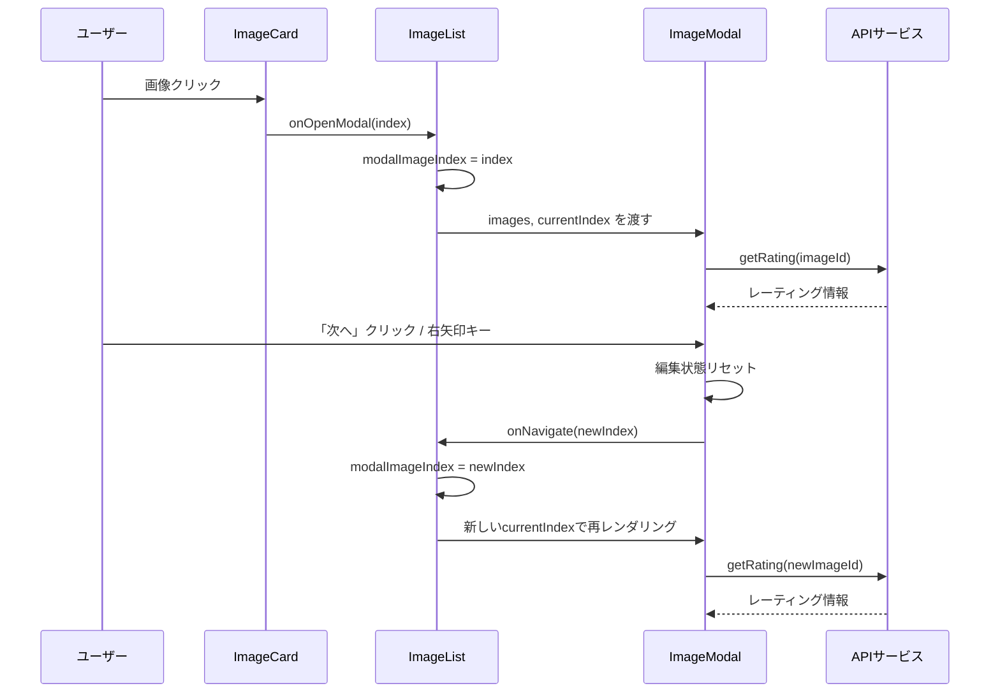

# 設計ドキュメント: 画像詳細ナビゲーション

## 概要

画像管理システムの管理画面（frontend-admin）において、ImageModal内で前後の画像に移動できるナビゲーション機能を追加する。現在の実装では、各ImageCardが独立してImageModalの表示状態を管理しているため、モーダル内から隣接する画像へ遷移することができない。

本設計では、モーダルの表示管理をImageListレベルに引き上げ、画像配列とインデックスをImageModalに渡すことで、モーダル内でのナビゲーションを実現する。

### 設計判断

1. **モーダル管理のリフトアップ**: ImageCardが個別に管理していたモーダル表示状態をImageListに集約する。これにより、ImageListが保持する画像配列のコンテキストをモーダルに渡せるようになる。
2. **インデックスベースのナビゲーション**: 画像IDではなく配列インデックスでナビゲーションを管理する。現在のページ内の画像配列に対してインデックスを使うことで、前後の判定がシンプルになる。
3. **キーボードナビゲーション**: 既存のESCキーハンドラを拡張し、左右矢印キーによるナビゲーションを追加する。
4. **編集状態のリセット**: 画像切り替え時にTagInputの入力中状態やローディング状態をリセットし、データの不整合を防ぐ。

## アーキテクチャ

### コンポーネント関係図

```mermaid
graph TD
    IL[ImageList] -->|images, currentIndex, onNavigate| IM[ImageModal]
    IL -->|image, thumbnailUrl, onOpenModal| IC[ImageCard]
    IC -->|onOpenModal(index)| IL
    IM -->|onClose, onUpdate| IL
    IM --> NB[NavigationButton]
    IM --> TI[TagInput]
    IM --> SR[StarRating]
```

### 状態管理フロー



## コンポーネントとインターフェース

### 1. ImageModal（変更）

現在のImageModalPropsを拡張し、ナビゲーション関連のpropsを追加する。

```typescript
interface ImageModalProps {
  image: ImageMetadata;
  onClose: () => void;
  onUpdate: () => void;
  // 新規追加
  images: ImageMetadata[];
  currentIndex: number;
  onNavigate: (index: number) => void;
}
```

**変更内容:**
- `images`: ImageListが保持する現在ページの画像配列
- `currentIndex`: 現在表示中の画像のインデックス
- `onNavigate`: インデックス変更時のコールバック
- 画像切り替え時に内部状態（`image`, `myRating`, `averageRating`, `ratingCount`, `loading`）をリセット
- キーボードイベントハンドラに左右矢印キーを追加
- NavigationButtonコンポーネントを画像表示エリアの左右に配置
- 「N / M」形式の位置インジケーターを表示

### 2. NavigationButton（新規）

モーダル内のナビゲーションボタンコンポーネント。

```typescript
interface NavigationButtonProps {
  direction: 'prev' | 'next';
  disabled: boolean;
  onClick: () => void;
}
```

**仕様:**
- `direction`: ボタンの方向（前へ / 次へ）
- `disabled`: 非活性状態（先頭で「前へ」、末尾で「次へ」）
- `onClick`: クリック時のコールバック
- 画像表示エリアの左端（prev）/ 右端（next）に配置
- アクセシビリティ: `aria-label`で「前の画像」「次の画像」を設定

### 3. ImageCard（変更）

モーダル表示の管理をImageListに委譲する。

```typescript
interface ImageCardProps {
  image: ImageMetadata;
  thumbnailUrl: string;
  selected: boolean;
  onSelect: () => void;
  onDelete: () => void;
  onUpdate: () => void;
  // 新規追加
  onOpenModal: () => void;
}
```

**変更内容:**
- `showModal`ステートと`ImageModal`レンダリングを削除
- `onOpenModal`コールバックを追加し、クリック時にImageListに通知
- ImageCard内のモーダル関連コードを除去してシンプル化

### 4. ImageList（変更）

モーダルの表示状態管理を追加する。

```typescript
// ImageList内の新規ステート
const [modalImageIndex, setModalImageIndex] = useState<number | null>(null);
```

**変更内容:**
- `modalImageIndex`ステートを追加（`null`でモーダル非表示、数値でモーダル表示中）
- `handleOpenModal(index: number)`: ImageCardクリック時にモーダルを開く
- `handleCloseModal()`: モーダルを閉じる（`modalImageIndex = null`）
- `handleNavigate(index: number)`: モーダル内ナビゲーション時にインデックスを更新
- ImageModalに`images`, `currentIndex`, `onNavigate`を渡す
- `onUpdate`コールバックで画像一覧を再読み込み


## データモデル

### 既存型（変更なし）

本機能では新しいAPIエンドポイントやデータモデルの追加は不要。既存の`ImageMetadata`型と`getRating` APIをそのまま利用する。

### 状態モデル

```typescript
// ImageList内のモーダル管理状態
interface ModalState {
  modalImageIndex: number | null;  // null = モーダル非表示, 0以上 = 表示中の画像インデックス
}

// ImageModal内のナビゲーション派生状態
interface NavigationState {
  currentImage: ImageMetadata;     // images[currentIndex]
  hasPrev: boolean;                // currentIndex > 0
  hasNext: boolean;                // currentIndex < images.length - 1
  positionLabel: string;           // `${currentIndex + 1} / ${images.length}`
}
```

### キーボードイベントマッピング

| キー | アクション | 条件 |
|------|-----------|------|
| `Escape` | モーダルを閉じる | 常時（既存） |
| `ArrowRight` | 次の画像へ移動 | `hasNext === true` |
| `ArrowLeft` | 前の画像へ移動 | `hasPrev === true` |


## 正確性プロパティ

*プロパティとは、システムのすべての有効な実行において成り立つべき特性や振る舞いのことである。人間が読める仕様と機械的に検証可能な正確性保証の橋渡しとなる形式的な記述である。*

### Property 1: 境界でのナビゲーションボタン無効化

*任意の*画像配列と任意のインデックスに対して、インデックスが0の場合は`hasPrev`がfalseとなり、インデックスが`length - 1`の場合は`hasNext`がfalseとなる。配列長が1の場合は両方がfalseとなる。

**Validates: Requirements 1.2, 1.3, 1.4**

### Property 2: ナビゲーション操作によるインデックス変化

*任意の*画像配列と任意の有効なインデックスに対して、「次へ」操作（ボタンクリックまたは右矢印キー）を行うとインデックスが1増加し、「前へ」操作（ボタンクリックまたは左矢印キー）を行うとインデックスが1減少する。ただし、境界（先頭で前へ、末尾で次へ）では操作が無視される。

**Validates: Requirements 2.1, 2.2, 2.3, 2.4**

### Property 3: 画像切り替え時の正しいデータ表示

*任意の*画像配列と任意のナビゲーション操作に対して、切り替え後に表示される画像のメタデータ（fileName, tags, isPublicなど）は、配列の新しいインデックスに対応する画像のものと一致する。

**Validates: Requirements 2.5, 3.2**

### Property 4: 画像切り替え時の編集状態リセット

*任意の*編集中状態（loading=true、タグ入力中など）において、画像ナビゲーションが実行された場合、loading状態はfalseにリセットされ、内部の画像状態は切り替え先の画像データで初期化される。

**Validates: Requirements 3.1**

### Property 5: 位置ラベルのフォーマット

*任意の*画像配列（長さN、N≥1）と任意の有効なインデックスi（0≤i<N）に対して、位置ラベルは`"${i+1} / ${N}"`の形式で表示される。

**Validates: Requirements 3.3**

### Property 6: ImageCardクリック時のインデックス設定

*任意の*画像配列において、k番目のImageCardがクリックされた場合、modalImageIndexはkに設定され、ImageModalにはimages[k]が表示される。

**Validates: Requirements 4.2**

## エラーハンドリング

### 画像切り替え時のAPIエラー

画像切り替え時に`getRating` APIがエラーを返した場合:
- エラーメッセージをコンソールに出力する（既存の動作と同様）
- レーティング情報はデフォルト値（myRating: null, averageRating: 0, ratingCount: 0）で表示する
- 画像のメタデータ（fileName, tags, isPublicなど）は配列から取得するため、APIエラーの影響を受けない
- ナビゲーション自体は正常に完了する（レーティング取得失敗でナビゲーションがブロックされない）

### 境界条件

- 画像配列が空の場合: ImageListでモーダルを開かない（`images.length === 0`のガード）
- インデックスが範囲外の場合: `onNavigate`内でクランプ処理（`Math.max(0, Math.min(index, images.length - 1))`）

### 画像更新後の整合性

- モーダル内で画像を更新（タグ追加、公開状態変更など）した後、`onUpdate`でImageListの画像一覧を再読み込みする
- 再読み込み後、`modalImageIndex`は維持されるが、画像の並び順が変わる可能性がある。現在のページ内の画像数が減少した場合（削除など）は、インデックスをクランプする

## テスト戦略

### プロパティベーステスト

プロパティベーステストライブラリとして**fast-check**を使用する。各テストは最低100回実行する。

各プロパティテストは設計ドキュメントのプロパティを参照するコメントタグを含める:
- タグ形式: `Feature: image-detail-navigation, Property {number}: {property_text}`

#### テスト対象プロパティ

1. **Property 1**: 境界でのナビゲーションボタン無効化
   - ジェネレーター: 任意の長さ（1〜100）の画像配列と、0〜length-1のインデックス
   - 検証: hasPrev/hasNextの計算結果が境界条件と一致すること

2. **Property 2**: ナビゲーション操作によるインデックス変化
   - ジェネレーター: 任意の画像配列、インデックス、操作方向（prev/next）
   - 検証: 操作後のインデックスが期待値と一致すること

3. **Property 3**: 画像切り替え時の正しいデータ表示
   - ジェネレーター: 任意の画像配列とナビゲーション操作のシーケンス
   - 検証: 各操作後に表示される画像データが配列の対応要素と一致すること

4. **Property 4**: 画像切り替え時の編集状態リセット
   - ジェネレーター: 任意の初期編集状態とナビゲーション操作
   - 検証: 操作後にloading=false、画像データが切り替え先のもので初期化されること

5. **Property 5**: 位置ラベルのフォーマット
   - ジェネレーター: 任意の配列長（1〜1000）とインデックス
   - 検証: ラベル文字列が`"${index+1} / ${length}"`と一致すること

6. **Property 6**: ImageCardクリック時のインデックス設定
   - ジェネレーター: 任意の画像配列とクリック対象のインデックス
   - 検証: modalImageIndexがクリックされたインデックスと一致すること

### ユニットテスト

ユニットテストはプロパティテストを補完し、具体的なシナリオとエッジケースをカバーする:

- **モーダル表示時のナビゲーションボタン存在確認**（要件1.1）: モーダルが開いた時に左右のNavigationButtonがレンダリングされること
- **画像1件時の両ボタン非活性**（要件1.4のエッジケース）: 配列長1でprev/nextの両方がdisabledであること
- **APIエラー時の動作**（要件3.4）: getRatingがエラーを返した場合にモーダルが現在の画像を維持すること
- **画像更新後の一覧再読み込み**（要件4.4）: onUpdateコールバックが呼ばれた時にloadImagesが実行されること
- **ESCキーでモーダルが閉じる**（既存動作の回帰テスト）: 矢印キー追加後もESCキーが正常に動作すること

### テストファイル構成

```
frontend-admin/src/components/
  NavigationButton.tsx
  NavigationButton.test.tsx        # NavigationButtonのユニットテスト
  ImageModal.test.tsx              # ImageModalのプロパティテスト + ユニットテスト
  ImageList.test.tsx               # ImageListのモーダル管理テスト
  ImageCard.test.tsx               # ImageCardの変更に対する回帰テスト
```
