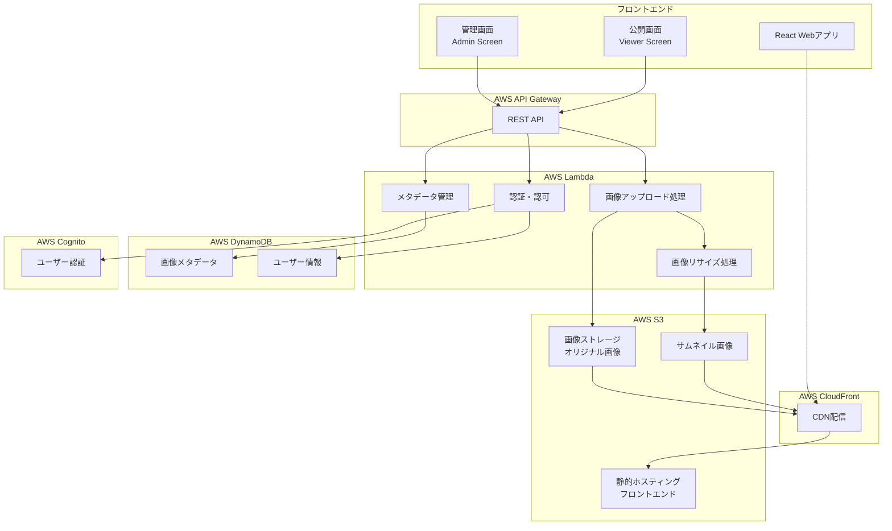

# 設計書

## 概要

AWS上で動作するサーバーレス画像管理システムの設計書です。管理者が画像をアップロード・管理し、一般公開された画像を誰でも閲覧できるWebアプリケーションを構築します。

### 主要機能
- 複数ファイル・フォルダ単位での画像アップロード
- タグ付けによる画像分類
- 3段階のユーザー権限管理（システム管理者・画像管理者・一般ユーザー）
- 画像ダウンロード機能（単一・一括）
- 無限スクロール対応の公開ギャラリー
- 画像拡大表示・スライドショー機能
- 管理画面でのページネーション・一括削除

## アーキテクチャ

### システム構成図



### サーバーレス構成の利点
- **自動スケーリング**: トラフィックに応じて自動的にスケール
- **コスト効率**: 使用した分だけの課金
- **運用負荷軽減**: サーバー管理不要
- **高可用性**: AWSの管理サービスによる高い可用性

## コンポーネントと インターフェース

### フロントエンド コンポーネント

#### 1. 管理画面（Admin Screen）
```typescript
// 主要コンポーネント
interface AdminScreenComponents {
  LoginForm: React.FC;           // ログイン画面
  ImageUpload: React.FC;         // 画像アップロード
  ImageList: React.FC;           // 画像一覧（ページネーション）
  ImageEditor: React.FC;         // 画像編集（タグ付け）
  BulkActions: React.FC;         // 一括操作
}

// 画像アップロード機能
interface ImageUploadProps {
  onMultipleUpload: (files: FileList) => Promise<void>;
  onFolderUpload: (files: FileList) => Promise<void>;
  supportedFormats: ['image/jpeg', 'image/jpg'];  // JPEG形式のみ
  maxFileSize: number;
}
```

#### 2. 公開画面（Viewer Screen）
```typescript
// 主要コンポーネント
interface ViewerScreenComponents {
  ImageGallery: React.FC;        // 画像ギャラリー（無限スクロール）
  ImageModal: React.FC;          // 画像拡大表示
  SearchFilter: React.FC;        // 検索・フィルター
  Slideshow: React.FC;           // スライドショー
}

// 無限スクロール機能
interface InfiniteScrollProps {
  loadMore: () => Promise<Image[]>;
  hasMore: boolean;
  loading: boolean;
  pageSize: number;
}
```

### バックエンド API

#### 1. 画像管理 API
```typescript
// REST API エンドポイント
interface ImageAPI {
  // 画像アップロード
  'POST /api/images/upload': {
    body: FormData;
    response: UploadResponse;
  };
  
  // 画像一覧取得（管理画面用）
  'GET /api/images/admin': {
    query: {
      page: number;
      limit: number;
      userId?: string;
    };
    response: PaginatedImageResponse;
  };
  
  // 画像一覧取得（公開画面用）
  'GET /api/images/public': {
    query: {
      cursor?: string;
      limit: number;
      tags?: string[];
      dateFrom?: string;
      dateTo?: string;
    };
    response: InfiniteScrollResponse;
  };
  
  // 画像削除
  'DELETE /api/images/:id': {
    response: DeleteResponse;
  };
  
  // 一括削除
  'DELETE /api/images/bulk': {
    body: { imageIds: string[] };
    response: BulkDeleteResponse;
  };
  
  // 画像ダウンロード
  'GET /api/images/:id/download': {
    response: Blob;
  };
  
  // 一括ダウンロード
  'POST /api/images/download/bulk': {
    body: { imageIds: string[] };
    response: Blob; // ZIP file
  };
  
  // 公開状態変更
  'PATCH /api/images/:id/visibility': {
    body: { isPublic: boolean };
    response: UpdateResponse;
  };
}
```

#### 2. 認証 API
```typescript
interface AuthAPI {
  // ログイン
  'POST /api/auth/login': {
    body: LoginRequest;
    response: AuthResponse;
  };
  
  // トークン検証
  'GET /api/auth/verify': {
    headers: { Authorization: string };
    response: UserInfo;
  };
}
```

### AWS Lambda 関数

#### 1. 画像アップロード処理
```typescript
// Lambda関数: imageUploadHandler
interface ImageUploadHandler {
  event: APIGatewayEvent;
  context: Context;
  
  // 処理フロー
  steps: [
    'ファイル検証',
    'S3アップロード',
    'サムネイル生成',
    'メタデータ抽出',
    'DynamoDB保存'
  ];
}
```

#### 2. 画像リサイズ処理
```typescript
// Lambda関数: imageResizeHandler
interface ImageResizeHandler {
  trigger: S3Event;
  
  // サムネイルサイズ
  thumbnailSizes: {
    small: { width: 150, height: 150 };
    medium: { width: 400, height: 400 };
    large: { width: 800, height: 600 };
  };
}
```

## データモデル

### DynamoDB テーブル設計

#### 1. 画像メタデータテーブル
```typescript
interface ImageMetadata {
  // プライマリキー
  PK: string;                    // "IMAGE#${imageId}"
  SK: string;                    // "METADATA"
  
  // 画像情報
  imageId: string;               // UUID
  fileName: string;              // オリジナルファイル名
  fileSize: number;              // ファイルサイズ（bytes）
  mimeType: string;              // MIME タイプ
  width: number;                 // 画像幅
  height: number;                // 画像高さ
  
  // メタデータ
  uploadedAt: string;            // アップロード日時（ISO 8601）
  capturedAt?: string;           // 撮影日時（EXIF）
  tags: string[];                // タグ配列
  isPublic: boolean;             // 公開状態
  
  // ユーザー情報
  ownerId: string;               // 所有者ID
  ownerName: string;             // 所有者名
  
  // ストレージ情報
  s3Key: string;                 // S3オブジェクトキー
  thumbnailKeys: {
    small: string;
    medium: string;
    large: string;
  };
  
  // 検索用
  GSI1PK: string;                // "USER#${ownerId}"
  GSI1SK: string;                // "${uploadedAt}#${imageId}"
  GSI2PK: string;                // "PUBLIC#${isPublic}"
  GSI2SK: string;                // "${capturedAt}#${imageId}"
}
```

#### 2. タグ管理テーブル
```typescript
interface TagMetadata {
  // プライマリキー
  PK: string;                    // "TAG#${tagName}"
  SK: string;                    // "METADATA"
  
  // タグ情報
  tagName: string;               // タグ名
  usageCount: number;            // 使用回数
  createdAt: string;             // 作成日時
  lastUsedAt: string;            // 最終使用日時
}
```

#### 3. ユーザー情報テーブル
```typescript
interface UserMetadata {
  // プライマリキー
  PK: string;                    // "USER#${userId}"
  SK: string;                    // "PROFILE"
  
  // ユーザー情報
  userId: string;                // Cognito User ID
  email: string;                 // メールアドレス
  displayName: string;           // 表示名
  role: 'SYSTEM_ADMIN' | 'IMAGE_MANAGER' | 'REGULAR_USER';  // ユーザー権限
  
  // 統計情報
  imageCount: number;            // アップロード画像数
  storageUsed: number;           // 使用ストレージ（bytes）
  
  // 日時情報
  createdAt: string;             // アカウント作成日時
  lastLoginAt: string;           // 最終ログイン日時
}
```

### DynamoDB インデックス設計

#### 1. GSI1: ユーザー別画像一覧
```typescript
interface GSI1 {
  PK: string;                    // "USER#${ownerId}"
  SK: string;                    // "${uploadedAt}#${imageId}"
  
  // 用途: 管理画面でのユーザー別画像一覧
  // ソート: アップロード日時の降順
}
```

#### 2. GSI2: 公開画像一覧
```typescript
interface GSI2 {
  PK: string;                    // "PUBLIC#true"
  SK: string;                    // "${capturedAt}#${imageId}"
  
  // 用途: 公開画面での画像一覧
  // ソート: 撮影日時の降順
}
```

### ページネーション戦略

#### 1. 管理画面（オフセットベース）
```typescript
interface AdminPagination {
  page: number;                  // ページ番号（1から開始）
  limit: number;                 // 1ページあたりの件数（50件固定）
  total: number;                 // 総件数
  totalPages: number;            // 総ページ数
}
```

#### 2. 公開画面（カーソルベース）
```typescript
interface PublicPagination {
  cursor?: string;               // 次のページのカーソル
  limit: number;                 // 1回の読み込み件数
  hasMore: boolean;              // 次のページの有無
}
```

## 正確性プロパティ

*プロパティとは、システムのすべての有効な実行において真であるべき特性や動作のことです。これらは人間が読める仕様と機械で検証可能な正確性保証の橋渡しとなります。*

### プロパティ1: 有効画像アップロード保存
*すべての*有効なJPEG画像ファイルについて、アップロード処理を実行すると、その画像がS3ストレージに正しく保存される
**検証: 要件 1.1**

### プロパティ2: 複数ファイル一括アップロード
*すべての*有効なJPEG画像ファイルの配列について、一括アップロード処理を実行すると、すべてのファイルがS3ストレージに保存される
**検証: 要件 1.2**

### プロパティ3: フォルダアップロード完全性
*すべての*JPEG画像ファイルを含むフォルダについて、フォルダアップロード処理を実行すると、フォルダ内のすべてのJPEG画像ファイルがS3ストレージに保存される
**検証: 要件 1.3**

### プロパティ4: 無効ファイル拒否
*すべての*JPEG以外のファイル形式について、アップロード処理を実行すると、エラーメッセージが返され、ファイルはS3ストレージに保存されない
**検証: 要件 1.4**

### プロパティ5: メタデータ自動生成
*すべての*画像ファイルについて、アップロード処理を実行すると、適切なメタデータ（ファイル名、サイズ、アップロード日時、所有者情報）がDynamoDBに保存される
**検証: 要件 1.5**

### プロパティ6: ファイルサイズ制限
*すべての*制限サイズを超えるファイルについて、アップロード処理を実行すると、エラーメッセージが返され、ファイルはS3ストレージに保存されない
**検証: 要件 1.7**

### プロパティ7: タグ追加保存
*すべての*画像とタグの組み合わせについて、タグ追加処理を実行すると、そのタグが画像のメタデータに正しく保存される
**検証: 要件 2.1**

### プロパティ8: タグ削除
*すべての*タグ付き画像について、特定のタグ削除処理を実行すると、そのタグが画像のメタデータから削除される
**検証: 要件 2.2**

### プロパティ9: 複数タグ追加
*すべての*画像と複数タグの組み合わせについて、複数タグ追加処理を実行すると、すべてのタグが画像のメタデータに保存される
**検証: 要件 2.3**

### プロパティ10: タグ重複防止
*すべての*既存タグ付き画像について、同じタグを再度追加しようとすると、重複が防がれ、タグは1つのみ保持される
**検証: 要件 2.5**

### プロパティ11: 無限スクロール読み込み
*すべての*スクロール位置について、次のページ読み込み処理を実行すると、指定件数の次の画像が正しく読み込まれる
**検証: 要件 3.2**

### プロパティ12: サムネイルクリック拡大表示
*すべての*サムネイル画像について、クリック処理を実行すると、対応する拡大画像がモーダルビューで表示される
**検証: 要件 3.3**

### プロパティ13: 拡大表示詳細情報
*すべての*画像について、拡大表示処理を実行すると、画像の詳細情報（ファイル名、撮影日時、タグ等）が含まれて表示される
**検証: 要件 3.4**

### プロパティ14: 拡大表示ナビゲーション
*すべての*画像について、拡大表示中に前後移動処理を実行すると、正しい前後の画像に移動できる
**検証: 要件 3.5**

### プロパティ15: ユーザー権限別画像表示
*すべての*Regular_Userについて、管理画面アクセス処理を実行すると、自分がアップロードした画像のみが表示される
**検証: 要件 4.1**

### プロパティ16: システム管理者全画像表示
*すべての*System_Adminについて、管理画面アクセス処理を実行すると、すべてのユーザーの画像が表示される
**検証: 要件 4.2**

### プロパティ17: 画像管理者全画像表示
*すべての*Image_Managerについて、管理画面アクセス処理を実行すると、すべてのユーザーの画像が表示される
**検証: 要件 4.3**

### プロパティ18: ページネーション正確性
*すべての*ページ番号について、ページネーション処理を実行すると、指定されたページの正しい画像（50件）が表示される
**検証: 要件 4.4**

### プロパティ19: 公開状態変更権限
*すべての*System_AdminまたはImage_Managerについて、任意の画像の公開状態変更処理を実行すると、Viewer_Screenでの表示状態が正しく更新される
**検証: 要件 4.6, 4.7**

### プロパティ20: 画像情報編集権限
*すべての*System_Adminについて、任意の画像の情報編集処理を実行すると、変更がメタデータに正しく反映される
**検証: 要件 4.8**

### プロパティ21: 選択状態管理
*すべての*画像について、チェックボックス操作を実行すると、選択状態が正しく管理される
**検証: 要件 4.10**

### プロパティ22: 一括削除実行
*すべての*チェックされた画像の組み合わせについて、一括削除処理を実行すると、チェックされたすべての画像が削除される
**検証: 要件 4.12**

### プロパティ23: アクセス制御
*すべての*Regular_Userについて、他のユーザーの画像に対する操作（アクセス・削除）を実行しようとすると、操作が拒否される
**検証: 要件 4.13, 5.8**

### プロパティ24: 画像管理者操作制限
*すべての*Image_Managerについて、画像の編集や削除を試みると、操作が拒否される
**検証: 要件 4.14, 5.9**

### プロパティ25: ページ情報表示
*すべての*ページについて、ページ表示処理を実行すると、現在のページ位置と総ページ数が正しく表示される
**検証: 要件 4.15**

### プロパティ26: 画像削除完全性
*すべての*画像について、削除処理を実行すると、画像がS3ストレージから削除され、関連するメタデータとタグもDynamoDBから削除される
**検証: 要件 5.4, 5.5**

### プロパティ27: 削除エラー時状態維持
*すべての*削除エラー状況について、削除処理でエラーが発生すると、元の状態が維持される
**検証: 要件 5.7**

### プロパティ28: 削除後ページ調整
*すべての*最後のページについて、ページ内の全画像を削除すると、前のページに自動的に移動する
**検証: 要件 5.11**

### プロパティ29: 画像ダウンロード権限
*すべての*System_AdminまたはImage_Managerについて、任意の画像のダウンロード処理を実行すると、オリジナル画像がダウンロードされる
**検証: 要件 6.1, 6.2**

### プロパティ30: 自分の画像ダウンロード
*すべての*Regular_Userについて、自分の画像のダウンロード処理を実行すると、オリジナル画像がダウンロードされる
**検証: 要件 6.3**

### プロパティ31: ダウンロードアクセス制御
*すべての*Regular_Userについて、他のユーザーの画像をダウンロードしようとすると、操作が拒否される
**検証: 要件 6.4**

### プロパティ32: 一括ダウンロード
*すべての*チェックされた画像の組み合わせについて、一括ダウンロード処理を実行すると、すべての画像がZIPファイルにまとめられてダウンロードされる
**検証: 要件 6.6**

### プロパティ33: キーワード検索
*すべての*検索キーワードについて、検索処理を実行すると、ファイル名とタグに基づく正しい検索結果が返される
**検証: 要件 7.1**

### プロパティ34: 複合フィルター
*すべての*フィルター条件の組み合わせ（タグ、撮影日）について、フィルター処理を実行すると、すべての条件に一致する画像のみが表示される
**検証: 要件 7.2, 7.3, 7.4**

### プロパティ35: フィルタークリア
*すべての*フィルター適用状態について、フィルタークリア処理を実行すると、すべての画像が再表示される
**検証: 要件 7.6**

### プロパティ36: リアルタイム検索更新
*すべての*検索条件変更について、検索条件を変更すると、リアルタイムで結果が更新される
**検証: 要件 7.7**

### プロパティ37: フィルター時無限スクロール維持
*すべての*フィルター適用状態について、フィルター適用後も無限スクロール機能が正常に動作する
**検証: 要件 7.8**

### プロパティ38: スライドショー開始
*すべての*画像一覧状態について、スライドショー開始処理を実行すると、自動スライドショーが開始される
**検証: 要件 8.1**

### プロパティ39: スライドショー自動移動
*すべての*スライドショー状態について、指定された間隔で次の画像に自動的に移動する
**検証: 要件 8.2**

### プロパティ40: スライドショー一時停止・再開
*すべての*スライドショー状態について、一時停止処理を実行すると自動移動が停止し、再開処理を実行すると自動移動が再開される
**検証: 要件 8.3, 8.4**

### プロパティ41: スライドショー手動操作
*すべての*スライドショー状態について、手動での前後移動処理を実行すると、正しい前後の画像に移動できる
**検証: 要件 8.5**

### プロパティ42: スライドショー終了時動作
*すべての*スライドショー設定について、最後の画像に到達すると、設定に応じて最初の画像に戻るか停止する
**検証: 要件 8.6**

### プロパティ43: スライドショー終了
*すべての*スライドショー状態について、終了処理を実行すると、通常の表示モードに戻る
**検証: 要件 8.7**

### プロパティ44: スライドショー位置表示
*すべての*スライドショー状態について、現在の画像位置が正しく表示される
**検証: 要件 8.8**

## エラーハンドリング

### 1. アップロードエラー
- **ファイルサイズ超過**: 制限サイズを超えるファイルは拒否し、適切なエラーメッセージを表示
- **無効ファイル形式**: JPEG以外の形式は拒否し、エラーメッセージを表示
- **ネットワークエラー**: アップロード中の接続エラーは再試行機能を提供
- **ストレージエラー**: S3への保存失敗時は適切なエラーメッセージを表示

### 2. 認証・認可エラー
- **認証失敗**: 無効な認証情報はログイン画面にリダイレクト
- **セッション期限切れ**: 期限切れセッションは再認証を要求
- **権限不足**: 権限のない操作は403エラーで拒否
- **不正アクセス**: 他ユーザーのデータアクセスは拒否

### 3. データ処理エラー
- **データベースエラー**: DynamoDB操作失敗時は適切なエラーメッセージを表示
- **データ不整合**: メタデータと実ファイルの不整合は自動修復または警告表示
- **削除エラー**: 削除失敗時は元の状態を維持し、エラーメッセージを表示

### 4. UI/UXエラー
- **読み込みエラー**: 画像読み込み失敗時は代替画像またはエラー表示
- **検索エラー**: 検索処理失敗時は適切なエラーメッセージを表示
- **ページネーションエラー**: 無効なページアクセス時は有効なページにリダイレクト

## テスト戦略

### デュアルテストアプローチ

本システムでは、**ユニットテスト**と**プロパティベーステスト**の両方を使用して包括的なテストカバレッジを実現します。

#### ユニットテスト
- **具体的な例**: 特定の入力に対する期待される出力を検証
- **エッジケース**: 境界値や特殊な条件での動作を検証
- **エラー条件**: 異常系の処理を検証
- **統合ポイント**: コンポーネント間の連携を検証

#### プロパティベーステスト
- **汎用プロパティ**: すべての入力に対して成り立つべき性質を検証
- **ランダム入力**: 大量のランダムな入力での動作を検証
- **不変条件**: システムの不変条件を検証
- **ラウンドトリップ**: データの往復変換での一貫性を検証

### プロパティベーステスト設定

#### テストライブラリ
- **フロントエンド**: fast-check（TypeScript/JavaScript用）
- **バックエンド**: fast-check（Node.js Lambda用）

#### テスト設定
- **最小実行回数**: 各プロパティテストは最低100回実行
- **タグ形式**: `**Feature: image-management, Property {番号}: {プロパティテキスト}**`
- **テスト分離**: 各正確性プロパティは単一のプロパティベーステストで実装

#### 例: プロパティテスト実装
```typescript
// プロパティ1のテスト例
describe('Feature: image-management, Property 1: 有効画像アップロード保存', () => {
  it('すべての有効な画像ファイルがS3に正しく保存される', async () => {
    await fc.assert(
      fc.asyncProperty(
        validImageFileArbitrary(),
        async (imageFile) => {
          const result = await uploadImage(imageFile);
          const s3Object = await getS3Object(result.s3Key);
          
          expect(result.success).toBe(true);
          expect(s3Object).toBeDefined();
          expect(s3Object.ContentLength).toBe(imageFile.size);
        }
      ),
      { numRuns: 100 }
    );
  });
});
```

### テストデータ生成戦略

#### スマートジェネレーター
- **有効画像**: JPEG形式の実際の画像データを生成
- **無効ファイル**: PNG、GIF、テキストファイル、実行ファイルなどのJPEG以外の形式を生成
- **ユーザーデータ**: 権限レベルの異なるユーザーを生成
- **メタデータ**: 現実的なファイル名、タグ、日時を生成

#### 制約条件
- **ファイルサイズ**: 1KB〜100MBの範囲で生成
- **タグ数**: 0〜20個の範囲で生成
- **ユーザー数**: 1〜1000ユーザーの範囲で生成
- **画像数**: 1〜10000画像の範囲で生成