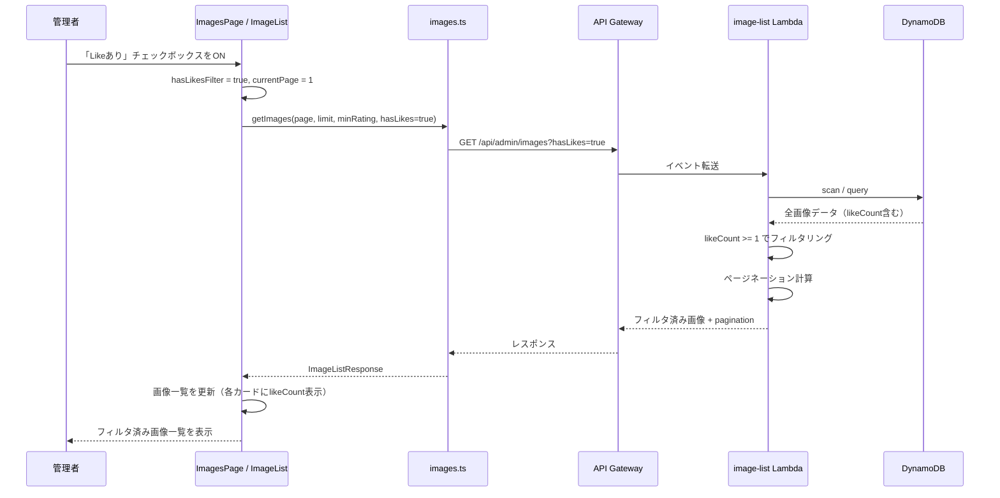
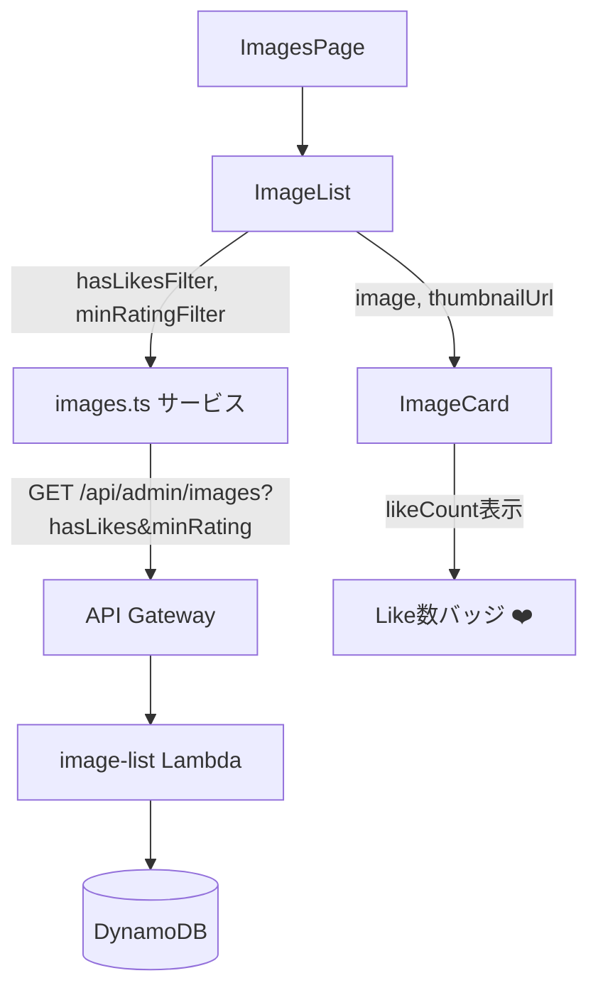

# 設計ドキュメント: Likeフィルター

## 概要

管理画面（frontend-admin）の画像一覧に、ビューアーでLikeが付いている画像のみを表示するフィルタリング機能を追加する。DynamoDBには既に`likeCount`フィールドが存在するが、画像一覧APIのレスポンスには含まれておらず、管理画面でのフィルタリングも未実装である。

本設計では以下の3層にわたる変更を行う:
1. **バックエンド**: `formatImageItem`関数に`likeCount`を追加し、`hasLikes`クエリパラメータによるフィルタリングを実装
2. **フロントエンド型定義**: `ImageMetadata`インターフェースに`likeCount`を追加、`getImages`関数に`hasLikes`パラメータを追加
3. **フロントエンドUI**: フィルターエリアに「Likeあり」トグルを追加、画像カードにLike数を表示

### 設計判断

1. **サーバーサイドフィルタリング**: `hasLikes=true`パラメータでバックエンド側でフィルタリングを行う。既存の`minRating`フィルターと同じパターン（全件取得後にメモリ内フィルタリング）を踏襲する。DynamoDBのGSI追加は不要で、既存のスキャン/クエリ結果に対してフィルタ条件を追加するだけで実現できる。
2. **チェックボックスUI**: 「Likeあり」フィルターはboolean（ON/OFF）なので、既存のレーティングフィルター（select）の隣にチェックボックスとして配置する。シンプルで直感的な操作を優先する。
3. **likeCount=0の非表示**: Like数が0の画像カードではLike表示を省略する。レーティング表示（`averageRating > 0`の場合のみ表示）と同じパターンを踏襲する。
4. **likeCountのオプショナル型**: 既存データとの後方互換性のため、`ImageMetadata`の`likeCount`はオプショナル（`number | undefined`）とする。未定義の場合は0として扱う。

## アーキテクチャ

### データフロー図



### コンポーネント関係図



## コンポーネントとインターフェース

### 1. image-list Lambda（変更）

`lambda/src/handlers/image-list.ts`を変更する。

**変更内容:**

- `hasLikes`クエリパラメータの取得を追加
- `getUserImages`と`getAllImages`関数に`hasLikes`パラメータを追加
- `likeCount >= 1`によるフィルタリングロジックを追加（`minRating`フィルターと同じパターン）
- `formatImageItem`関数に`likeCount`フィールドを追加

```typescript
// クエリパラメータの取得（追加分）
const hasLikes = event.queryStringParameters?.hasLikes === 'true';

// フィルタリングロジック（getUserImages, getAllImages内に追加）
if (hasLikes) {
  allItems = allItems.filter(item => (item.likeCount || 0) >= 1);
}

// formatImageItem関数の変更
function formatImageItem(item: any): any {
  return {
    // ...既存フィールド
    likeCount: item.likeCount || 0,
  };
}
```

### 2. フロントエンド型定義（変更）

`frontend-admin/src/types/index.ts`を変更する。

```typescript
// ImageMetadataインターフェースに追加
export interface ImageMetadata {
  // ...既存フィールド
  likeCount?: number;
}
```

### 3. images.tsサービス（変更）

`frontend-admin/src/services/images.ts`の`getImages`関数を変更する。

```typescript
export const getImages = async (
  page: number = 1,
  limit: number = 50,
  minRating?: number,
  hasLikes?: boolean
): Promise<ImageListResponse> => {
  const params: Record<string, any> = { page, limit };
  if (minRating && minRating > 0) {
    params.minRating = minRating;
  }
  if (hasLikes) {
    params.hasLikes = 'true';
  }
  const response = await apiClient.get<{ data: ImageListResponse }>('/api/admin/images', {
    params,
  });
  return response.data.data;
};
```

### 4. ImageList（変更）

`frontend-admin/src/components/ImageList.tsx`を変更する。

**変更内容:**
- `hasLikesFilter`ステートを追加
- フィルターエリアに「Likeあり」チェックボックスを追加
- `loadImages`で`hasLikesFilter`を`getImages`に渡す
- フィルター変更時にページを1にリセット

```typescript
const [hasLikesFilter, setHasLikesFilter] = useState<boolean>(false);

// loadImages内
const response = await getImages(
  page,
  PAGINATION_CONFIG.itemsPerPage,
  minRatingFilter > 0 ? minRatingFilter : undefined,
  hasLikesFilter || undefined
);

// useEffectの依存配列にhasLikesFilterを追加
useEffect(() => {
  loadImages(currentPage);
}, [currentPage, minRatingFilter, hasLikesFilter]);

// フィルターUI
<label>
  <input
    type="checkbox"
    checked={hasLikesFilter}
    onChange={(e) => { setHasLikesFilter(e.target.checked); setCurrentPage(1); }}
  />
  Likeあり
</label>
```

### 5. ImageCard（変更）

`frontend-admin/src/components/ImageCard.tsx`を変更する。

**変更内容:**
- レーティング表示の下にLike数バッジを追加
- `likeCount`が1以上の場合のみ表示

```typescript
{/* Like数表示 */}
{(image.likeCount !== undefined && image.likeCount > 0) && (
  <div className="card-likes">
    <span>❤️ {image.likeCount}</span>
  </div>
)}
```

## データモデル

### DynamoDB（変更なし）

`likeCount`フィールドは既にDynamoDBの画像メタデータに存在する。スキーマ変更は不要。

### APIレスポンス変更

画像一覧APIのレスポンスに`likeCount`フィールドが追加される。

```typescript
// 変更前
{
  imageId: "abc123",
  fileName: "photo.jpg",
  // ...
  averageRating: 4.5,
  ratingCount: 10
}

// 変更後
{
  imageId: "abc123",
  fileName: "photo.jpg",
  // ...
  averageRating: 4.5,
  ratingCount: 10,
  likeCount: 5  // 新規追加
}
```

### APIクエリパラメータ変更

| パラメータ | 型 | 必須 | 説明 |
|-----------|-----|------|------|
| page | number | いいえ | ページ番号（デフォルト: 1） |
| userId | string | いいえ | ユーザーIDフィルター |
| minRating | number | いいえ | 最低レーティング（既存） |
| hasLikes | string | いいえ | `"true"`の場合、likeCount >= 1の画像のみ返却（新規） |

### フロントエンド状態モデル

```typescript
// ImageList内の新規ステート
interface FilterState {
  minRatingFilter: number;    // 既存
  hasLikesFilter: boolean;    // 新規追加
}
```


## 正確性プロパティ

*プロパティとは、システムのすべての有効な実行において成り立つべき特性や振る舞いのことである。人間が読める仕様と機械的に検証可能な正確性保証の橋渡しとなる形式的な記述である。*

### Property 1: formatImageItemはlikeCountを数値で返却する

*任意の*DynamoDB画像アイテムに対して、`formatImageItem`関数の出力には`likeCount`フィールドが数値型で含まれる。元データの`likeCount`が未定義またはnullの場合は`0`が返却される。

**Validates: Requirements 1.1, 1.2**

### Property 2: hasLikesフィルタリングの正確性

*任意の*画像リスト（likeCountが0のものと1以上のものが混在）に対して、`hasLikes=true`でフィルタリングした場合、結果のすべてのアイテムの`likeCount`が1以上である。`hasLikes`が未指定の場合、フィルタリング前後で画像数が変わらない。

**Validates: Requirements 2.1, 2.2**

### Property 3: 複合フィルタリングの正確性

*任意の*画像リストと任意の`minRating`値に対して、`hasLikes=true`と`minRating`を同時に適用した場合、結果のすべてのアイテムが`likeCount >= 1`かつ`averageRating >= minRating`の両方を満たす。

**Validates: Requirements 2.3**

### Property 4: フィルタリング後のページネーション計算

*任意の*画像リストとフィルタ条件（hasLikes, minRating）に対して、レスポンスの`totalCount`はフィルタ条件を満たすアイテムの総数と一致し、`totalPages`は`Math.ceil(totalCount / PAGE_SIZE)`と一致する。

**Validates: Requirements 2.4**

### Property 5: フィルター変更時のページリセット

*任意の*現在のページ番号とフィルター状態に対して、「Likeあり」フィルターの状態が変更された場合、`currentPage`は1にリセットされる。

**Validates: Requirements 3.4**

### Property 6: Like数の表示フォーマット

*任意の*`likeCount`が1以上の画像に対して、画像カードのレンダリング結果にはハートアイコン（❤️）と`likeCount`の数値が含まれる。`likeCount`が0またはundefinedの場合、Like数の表示要素は存在しない。

**Validates: Requirements 4.1, 4.2, 4.3**

## エラーハンドリング

### hasLikesパラメータの不正値

`hasLikes`クエリパラメータに`"true"`以外の値（例: `"false"`, `"1"`, 空文字）が指定された場合:
- フィルタリングを適用しない（`hasLikes === 'true'`の厳密比較で判定）
- エラーレスポンスは返さず、通常の全件取得として処理する
- これは既存の`minRating`パラメータの処理パターン（`parseFloat`で数値変換、NaNの場合はundefined）と同様の寛容な処理方針

### likeCountフィールドの欠損

DynamoDBの画像アイテムに`likeCount`フィールドが存在しない場合（古いデータなど）:
- `formatImageItem`内で`item.likeCount || 0`としてデフォルト値0を設定
- フロントエンドでも`image.likeCount ?? 0`で安全にアクセス
- フィルタリング時も`(item.likeCount || 0) >= 1`で未定義を0として扱う

### APIエラー時のフィルター状態

画像一覧APIがエラーを返した場合:
- 既存のエラーハンドリング（`setError`でエラーメッセージ表示）がそのまま適用される
- フィルター状態（`hasLikesFilter`, `minRatingFilter`）は維持される
- ユーザーがフィルターを変更するか、ページをリロードすることで再取得可能

## テスト戦略

### プロパティベーステスト

プロパティベーステストライブラリとして**fast-check**を使用する。各テストは最低100回実行する。

各プロパティテストは設計ドキュメントのプロパティを参照するコメントタグを含める:
- タグ形式: `Feature: like-filter, Property {number}: {property_text}`

#### テスト対象プロパティ

1. **Property 1**: formatImageItemはlikeCountを数値で返却する
   - ジェネレーター: 任意のDynamoDB画像アイテム（likeCountがundefined, null, 0, 正の整数のいずれか）
   - 検証: 出力のlikeCountがnumber型であり、元データが未定義の場合は0であること

2. **Property 2**: hasLikesフィルタリングの正確性
   - ジェネレーター: 任意の画像リスト（likeCountが0〜100のランダム値）とhasLikesフラグ（true/false/undefined）
   - 検証: hasLikes=trueの場合は全アイテムのlikeCount >= 1、未指定の場合はアイテム数が変わらないこと

3. **Property 3**: 複合フィルタリングの正確性
   - ジェネレーター: 任意の画像リスト、minRating（0〜5）、hasLikes（true/undefined）
   - 検証: 結果の全アイテムがlikeCount >= 1かつaverageRating >= minRatingを満たすこと

4. **Property 4**: フィルタリング後のページネーション計算
   - ジェネレーター: 任意の画像リスト（0〜200件）とフィルタ条件
   - 検証: totalCountとtotalPagesが正しく計算されること

5. **Property 5**: フィルター変更時のページリセット
   - ジェネレーター: 任意の現在ページ番号（1〜100）とフィルター状態の変更
   - 検証: 変更後のcurrentPageが1であること

6. **Property 6**: Like数の表示フォーマット
   - ジェネレーター: 任意のlikeCount（0〜10000）
   - 検証: likeCount >= 1の場合は❤️と数値が表示され、0の場合はLike表示要素が存在しないこと

### ユニットテスト

ユニットテストはプロパティテストを補完し、具体的なシナリオとエッジケースをカバーする:

- **フィルターUI存在確認**（要件3.1）: ImageListコンポーネントに「Likeあり」チェックボックスが存在すること
- **チェックボックスON時のAPI呼び出し**（要件3.2）: チェックボックスをONにした時に`hasLikes=true`パラメータでAPIが呼ばれること
- **チェックボックスOFF時のAPI呼び出し**（要件3.3）: チェックボックスをOFFにした時に`hasLikes`パラメータなしでAPIが呼ばれること
- **両フィルター同時使用**（要件3.5）: minRatingとhasLikesの両方が設定された状態でAPIが正しいパラメータで呼ばれること
- **likeCount=0の画像カード**（要件4.2のエッジケース）: likeCountが0の画像カードにLike表示要素が存在しないこと
- **likeCount未定義の画像カード**（要件4.2のエッジケース）: likeCountがundefinedの画像カードにLike表示要素が存在しないこと

### テストファイル構成

```
lambda/src/handlers/
  image-list.ts
  image-list.test.ts              # formatImageItem + フィルタリングロジックのプロパティテスト + ユニットテスト

frontend-admin/src/components/
  ImageList.tsx
  ImageList.test.tsx              # フィルターUI + ページリセットのテスト
  ImageCard.tsx
  ImageCard.test.tsx              # Like数表示のプロパティテスト + ユニットテスト

frontend-admin/src/services/
  images.ts
  images.test.ts                  # getImages関数のパラメータ渡しテスト
```
